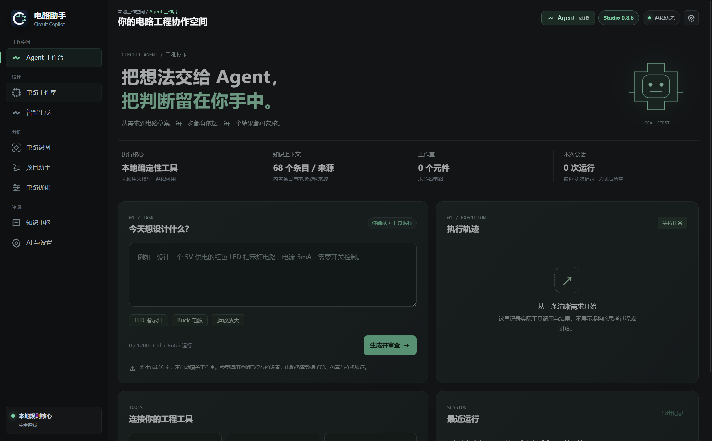
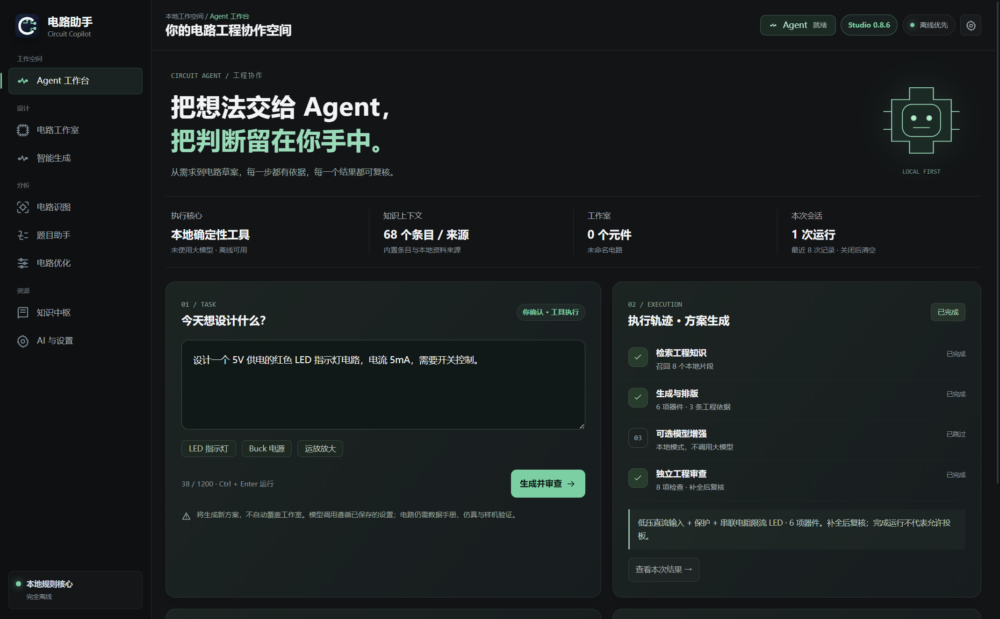

# 电路助手 Studio：问题修复与 Agent 工作台改进报告

日期：2026-09-09  
对应任务：[T001](../04_Tasks/T001_agent_workspace/plan.md)  
交付范围：源代码改进、回归测试、实际 Electron 界面截图及本文档。**未重新打包已有便携版 EXE。**

## 1. 改进目标与实际执行顺序

本轮先检查现有 Electron 应用、核心算法、文件存储和测试，再实际修改代码、运行回归及界面检查，最后编写本报告。没有把概念设计或静态效果图当成已经实现的功能。

原有电路工作室、知识中枢、题目助手及电路生成能力保持原技术栈。新增 Agent 工作台作为入口，将已有的工程工具串联为可观察、可复核的任务流程。

## 2. 已修复的问题

| 问题 | 原因与影响 | 实际修改 | 验证 |
| --- | --- | --- | --- |
| 兆欧误读为毫欧 | 求解前整体转小写，`1MΩ` 变成 `1mΩ`；5V 条件下结果会从 5µA 错成 5kA | 数值提取保留 SI 前缀大小写，语义匹配使用独立小写文本 | M/m/k/meg/中文欧姆端到端测试及 Electron 输入验证 |
| 并发保存丢项目 | 多次保存/删除同时读旧数组再覆盖文件 | 共享进程内 FIFO 队列包住读改写；同目录临时文件写入、sync 后 rename；新项目 UUID | 40 项并发保存、保存删除交错、原子替换失败恢复 |
| 损坏数据被当作空库 | 读取时将所有异常吞掉并返回默认数组 | 只有 ENOENT 使用默认值；损坏 JSON、权限错误和非法项目结构报错并保留原件 | 隔离临时目录与文件系统 mock 验证 |
| 远程 Ollama 收到本地片段 | 仅按 provider 名称推断数据留在本机 | 根据实际端点判断，只有回环端点允许附加检索正文；所有请求拒绝重定向 | 回环 IPv4/IPv6、远程、伪装主机和真实请求构造 mock |
| 重复快捷键造成生成竞争 | 按钮禁用不等于函数调用被锁定 | Agent 工作流互斥；生成、修订与审查共享运行状态 | 双次 Ctrl+Enter 只产生一条运行记录 |
| 其他页面快捷键修改隐藏画布 | 绘图快捷键注册在全局 window | 非工作室页面不处理绘图快捷键 | 跳转 Agent 后 Delete 不减少画布元件 |
| 窄屏属性栏无法恢复 | 媒体查询强制隐藏面板，恢复按钮只移除 class | 窄屏采用可展开浮层；收起后让出画布；网格允许内容收缩 | 1120px 属性栏收起/展开与截图检查 |

本报告只声称以上已确认问题得到处理，不代表对整个应用完成了穷尽式缺陷审计。

## 3. 界面与 Agent 元素

### 3.1 新的首页

首页包含独立 Agent 标识、工程协作标题、任务输入区与上下文概览。颜色沿用深色工程环境，以薄荷绿区分执行入口，调整低对比辅助文字，保留本地 SVG 图标，不依赖在线字体或图片。



上下文概览来自当前状态：执行核心、知识条目/来源数量、画布元件数量、项目名称和会话运行数。知识数量不是知识准确率；运行数也不是工程验证通过数。

### 3.2 可操作的任务流程

输入需求后点击“生成并审查”，或按 `Ctrl+Enter`，依次执行：

1. 本地 SQLite 知识检索；失败时明确记录降级。
2. 确定性电路生成、参数计算与排版。
3. 可选模型增强；本地模式或模型未连接时明确跳过。
4. 独立工程审查并生成结果。

这些是工具阶段，不是多个独立大模型。界面不展示伪造的思考过程，也不通过定时动画假装任务正在推进。快速的本地步骤可能在一个界面刷新周期内完成。



“已完成”仅表示工作流结束，审查结果仍可能要求补充或阻断投板。是否允许下一步，必须阅读结果中的工程边界。

### 3.3 工具与记录

- **审查当前画布**：调用已有优化工具，只读分析，不自动改线或换器件。
- **公式求解 / 知识中枢**：直接进入对应已有功能，不暗示这些入口启动了新的后台模型。
- **查看本次结果**：打开最新运行对应的生成或审查页面。
- **最近运行**：内存中最多保留 8 次任务快照，显示标题、时间和摘要；关闭应用后清空。
- **导出记录**：用户选择保存位置后导出 JSON。记录含需求与结果摘要，分享前请检查业务敏感内容。此次未自动操作系统保存对话框，因此该交互未列入 GUI 通过项。

### 3.4 响应式与可访问性

已检查 1440px 和 1120px 外窗宽度的工作台横向溢出；内容较高时允许纵向滚动。窄屏属性栏可按需展开，收起后显示完整画布。新增输入有文本标签，状态有 `aria-live`，导航有 `aria-current`，支持减少动画偏好。

这些措施不等于完成 WCAG 合规认证；屏幕阅读器、全部缩放比例及触控设备仍需专项测试。

## 4. 使用方法

在项目根目录运行：

```powershell
npm.cmd start
```

1. 启动后进入 Agent 工作台。
2. 选择 LED/Buck/运放示例，或输入自己的电路需求。
3. 点击“生成并审查”，查看阶段结果和模型是否被跳过。
4. 点击“查看本次结果”，查看原理图、BOM 与工程校验。
5. 点击“发送到工作室”才会载入画布；已有未保存改动时保留原有确认机制。
6. 在智能生成页输入“改为 12V 供电”等修订需求，生成新版本；Agent 工作台同步记录这次运行。
7. 回到工作台点击“审查当前画布”，获得建议，不自动修改项目。

**不要直接打开旧的 `release-0.8.6` EXE 来验收本次源码修改。**该目录中的历史构建不会自动更新。本轮没有覆盖它，也没有修改版本号。

## 5. 实现结构

| 文件 | 职责 |
| --- | --- |
| `src/shared/agent-run.mjs` | 可测试的运行状态、步骤状态、互斥及有界历史 |
| `src/renderer/app.js` | 接入生成/修订/审查，渲染上下文与运行轨迹，限制画布快捷键作用域 |
| `src/renderer/index.html` | 工作台、入口、工具卡片、状态和历史容器 |
| `src/renderer/styles.css` | 工作台视觉、响应式侧栏及减少动画规则 |
| `src/main/storage.cjs` | 队列、原子写入、错误保护及 UUID |
| `src/main/ai-provider.cjs` | 实际端点隐私判断和禁止重定向 |
| `src/shared/core.mjs` | 保留工程单位前缀大小写 |
| `src/main/agent-smoke.cjs` | 隔离 Electron 操作检查与截图 |
| `scripts/verify-tests.mjs` | 运行测试并保存 TAP 证据 |

本轮未引入新的 npm 依赖，也未切换前端框架。原有 Electron 隔离、sandbox 与 CSP 保持开启。

## 6. 测试与证据

### 单元和回归测试

初始基线为 **48 通过**；本轮最终为 **63 通过、0 失败、0 跳过**。测试包含既有模板连通性和新增存储、隐私、单位及 Agent 状态测试。

```powershell
npm.cmd test
node scripts/verify-tests.mjs
```

第二条命令将结果保存到 [TAP 日志](../04_Tasks/T001_agent_workspace/files/unit-tests.tap)。

### Electron 界面实测

最终 **15 项检查全部通过**，包含：默认首页、空需求、重复提交、模型跳过、画布不被自动覆盖、原理图跳转、发送画布、快捷键隔离、审查、修订、5µA 计算、两档宽度溢出、侧栏恢复及交互期间未捕获异常。

```powershell
.\node_modules\electron\dist\electron.exe . --agent-smoke --evidence-dir=04_Tasks/T001_agent_workspace/files
```

该命令使用系统临时目录 `circuit-agent-smoke-<进程号>` 作为独立 userData，默认本地规则模式。未读取或修改日常用户项目；可能保留隔离测试临时目录。结果见 [UI 检查 JSON](../04_Tasks/T001_agent_workspace/files/ui-smoke.json)。

截图在测试中通过真实 Electron `capturePage` 生成，并进行了目视复核；不是前端效果图。

## 7. 未完成验证及已知限制

- **未验证真实远程模型**：AI 请求使用 mock；界面实测为本地规则模式，不能据此宣称 Ollama 或远程视觉模型已经可用。
- **服务状态不是能力证明**：现有连接探测不保证指定模型已安装、支持视觉或能够完成下一次推理。
- **隐私限制有范围**：保护的是自动附加的 `knowledgeContext` 正文；需求本身及方案元数据可能发送至用户配置的模型。回环服务也可能自行代理外发，本应用无法保证其行为。
- **没有仿真与实测**：未运行 SPICE、ERC/DRC、热分析或硬件测试；示例仍是概念级/参数化草案，不能直接投板。
- **存储锁限单进程**：没有多进程文件锁；未执行断电测试，崩溃可能留下临时文件。
- **Agent 不支持取消与长期记忆**：没有跨重启任务恢复；历史导出仅保存记录，不恢复此前版本原理图。
- **现有绘图布局仍可继续改善**：个别元件标签在紧凑布局中可能拥挤，本轮没有全面重排所有模板。
- **未重新构建发行包**：后续建议先人工验收源码版，再生成新版本便携包并做发布测试。
- **任务同步环境差异**：本机未找到 Bun；已使用 Node.js 24.15.0 执行同一 `scripts/sync_tasks_board.ts` 单向重建看板。会话 Todo 未自动回写计划时，已按稳定 Step ID 精确同步。

## 8. 结论与下一步

本轮完成了“发现实际缺陷—源码修复—Agent 工作台集成—自动化验证—文档交付”的闭环。Agent 元素的价值在于把已有工具的动作、依据与结果显示出来，而不是增加一个无法兑现能力的聊天外观。

建议下一步：人工确认视觉和操作体验后发布新便携版；再分任务推进真实模型联调、多进程存储保护、任务恢复和电路仿真验证。

## 参考文献与物理直链 (References & File Links)

- [任务与验收](../04_Tasks/T001_agent_workspace/okr.md)
- [执行记录](../04_Tasks/T001_agent_workspace/memory.md)
- [测试日志](../04_Tasks/T001_agent_workspace/files/unit-tests.tap)
- [界面检查](../04_Tasks/T001_agent_workspace/files/ui-smoke.json)
- [1440px 工作台](../04_Tasks/T001_agent_workspace/files/agent-1440.png)
- [1120px 工作台](../04_Tasks/T001_agent_workspace/files/agent-1120.png)
- [1120px 工作室](../04_Tasks/T001_agent_workspace/files/studio-1120.png)
